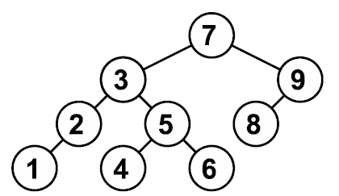

# Двоичные деревья поиска

## Задача №3557. Бинарное дерево (вставка, поиск, удаление)

Напишите программу, которая будет реализовывать действия в бинарном дереве поиска «вставить», «удалить» и «найти» (по значению). Программа должна обрабатывать запросы четырёх видов:

**ADD n** — если указанного числа еще нет в дереве, вставлять его и выводить слово «DONE», если уже есть — оставлять дерево как было и выводить слово «ALREADY».

**DELETE n** — если указанное число есть в дереве, удалять его и выводить слово «DONE», если нет — оставлять дерево как было и выводить слово «CANNOT». При удалении элемента, имеющего два сына, обязательно обменивать значение с максимальным элементом левого поддерева.

**SEARCH** — следует выводить слово «YES» (если значение найдено в дереве) или слово «NO» (если не найдено). Дерево при этом не меняется.

**PRINTTREE** — выводить все дерево, обязательно используя алгоритм, указанный в формате вывода результатов.

**Входные данные:**

В каждой строке входных данных записан один из запросов ADD n или DELETE n или SEARCH n или PRINTTREE. Гарантируется, что запросы PRINTTREE будут вызываться только в моменты, когда дерево не пустое. Общее количество запросов не превышает 1000, из них не более 20 запросов PRINTTREE.

**Выходные данные:**

Для каждого запроса выводите ответ на него. Для запросов ADD, DELETE и SEARCH — соответствующее слово в отдельной строке. На запрос PRINTTREE надо выводить дерево, обязательно согласно такому алгоритму:

```C++
template<class T> void print_tree(Node<T> *p, int level)

{

if(p==NULL)

    return;

print_tree(p->left, level+1);

for(int i=0; i<level; i++)

    cout << ".";

cout << p->data << endl;

print_tree(p->right, level+1);

}
```

(Изначальный вызов этой функции — print_tree(root,0).)

### Пример:

| **Входные данные**  |
| ------------------- |
| ADD 2               |
| ADD 7               |
| ADD 5               |
| PRINTTREE           |
| ADD 5               |
| DELETE 3            |
| ADD 0               |
| PRINTTREE           |
| DELETE 7            |
| PRINTTREE           |
| **Выходные данные** |
| DONE                |
| DONE                |
| DONE                |
| 2                   |
| ..5                 |
| .7                  |
| ALREADY             |
| CANNOT              |
| DONE                |
| .0                  |
| 2                   |
| ..5                 |
| .7                  |
| DONE                |
| .0                  |
| 2                   |
| .5                  |

### [Решение](binary_tree_A/A.py)

## Задача №757. Количество уровней дерева

Реализуйте бинарное дерево поиска для целых чисел. Программа получает на вход последовательность целых чисел и строит из них дерево. Элементы в деревья добавляются в соответствии с результатом поиска их места. Если элемент уже существует в дереве, добавлять его не надо. Балансировка дерева не производится.

**Входные данные:**

На вход программа получает последовательность натуральных чисел. Последовательность завершается числом 0, которое означает конец ввода, и добавлять его в дерево не надо.

**Выходные данные:**

Выведите единственное число – количество уровней получившегося дерева.

Пример соответствует следующему дереву:



### Пример:

| **Входные данные**  |
| ------------------- |
| 7 3 2 1 9 5 4 6 8 0 |
| **Выходные данные** |
| 4                   |

### [Решение](amount_of_tree_levels_B/B.py)

## Задача №758. Количество элементов

Подсчитайте количество элементов в получившемся дереве и выведите это количество.

**Входные данные:**

Вводится последовательность целых чисел, оканчивающаяся нулем. Сам ноль в последовательность не входит.

**Выходные данные:**

Выведите ответ на задачу.

### Пример:

| **Входные данные**  |
| ------------------- |
| 7 3 2 1 9 5 4 6 8 0 |
| **Выходные данные** |
| 9                   |

### [Решение](amount_els_C/C.py)

## Задача №759. Второй максимум

Выведите второй по величине элемент в построенном дереве. Гарантируется, что такой найдется.

**Входные данные:**

Дана последовательность целых чисел, оканчивающаяся нулем. Сам ноль в последовательность не входит.

**Выходные данные:**

Выведите ответ на задачу.

### Пример:

| **Входные данные**  |
| ------------------- |
| 7 3 2 1 9 5 4 6 8 0 |
| **Выходные данные** |
| 8                   |

### [Решение](second_maximum_D/D.py)
